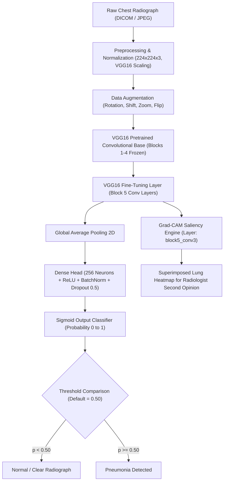

# Project Synopsis & Academic Documentation

## Project Title
**A Deep CNN with Transfer Learning (VGG16) for X-ray Pneumonia Detection**

- **Candidate:** BONTHU SRI LAKSHMI
- **Project Supervisor:** Mr. R. SriRamu
- **Domain:** Deep Learning & Computer Vision
- **Target Deliverable:** Clinical Second-Opinion Radiologist Support Tool
- **Keywords:** Chest X-ray, Pneumonia Detection, Deep Learning, CNN, Transfer Learning, VGG16, Grad-CAM, Second-Opinion Tool

---

## 1. Abstract
Pneumonia is an acute respiratory infection affecting the lungs and remains one of the leading causes of morbidity and mortality worldwide, particularly among young children, the elderly, and immunocompromised patients. While chest radiography (X-ray) is the most standard, cost-effective, and readily accessible diagnostic modality, accurate radiological interpretation is challenged by overlapping anatomical structures, subjective variability, and shortfalls in certified radiologists across resource-constrained regions. 

The present work builds a deep Convolutional Neural Network (CNN) with transfer learning using the VGG16 architecture to classify chest X-rays as either **Normal** or **Pneumonia-affected**, addressing the diagnostic challenge through an empirical, data-driven methodology. Radiographic data sourced from the **ChestX-ray14** dataset is systematically preprocessed, augmented, and standardized. The feature extraction layers of VGG16, pre-trained on ImageNet, are repurposed with custom fully-connected classification layers, followed by fine-tuning of upper convolutional blocks (`Block 5`). To transition the model from academic benchmarking into clinical utility, an Explainable AI (XAI) module powered by **Grad-CAM (Gradient-weighted Class Activation Mapping)** and an interactive **Streamlit Radiologist Second-Opinion Tool** are delivered, enabling practical, transparent adoption beyond the classroom.

---

## 2. Problem Statement & Motivation
- **Clinical Challenge:** Differentiating bacterial or viral pneumonia from normal lung parenchymal patterns requires identifying subtle opacities, consolidations, and infiltrates. In remote or overburdened healthcare centers, immediate radiologist availability is scarce, leading to delayed treatment.
- **Computer Vision Challenge:** Training deep neural networks from scratch on medical datasets often yields severe overfitting due to limited labeled data and high parameter complexity.
- **Solution:** Employing **Transfer Learning** with VGG16 preserves generic visual feature hierarchies (edges, textures, spatial contours) acquired from large-scale natural imagery, adapting them to chest radiograph pathology with high sensitivity and specificity.

---

## 3. System Architecture & Methodology

### 3.1 Two-Stage Transfer Learning Process
1. **Stage 1 (Feature Extraction):**
   - VGG16 backbone weights (ImageNet) are completely frozen.
   - The top dense layers (Global Average Pooling, Dense 256, Dropout, Sigmoid) are trained using the Adam optimizer with initial learning rate $\alpha = 10^{-4}$.
2. **Stage 2 (Fine-Tuning Domain Adaptation):**
   - Unfreezing the final convolutional block (`block5_conv1`, `block5_conv2`, `block5_conv3`).
   - Re-training at an attenuated learning rate $\alpha = 10^{-5}$ to refine high-level radiographic feature detectors without catastrophic forgetting.

---

## 4. Mathematical Foundations

### 4.1 Binary Cross-Entropy Loss
For $N$ chest radiograph samples, the loss function is expressed as:
$$\mathcal{L}_{BCE} = -\frac{1}{N} \sum_{i=1}^{N} \left[ y_i \log(\hat{y}_i) + (1 - y_i) \log(1 - \hat{y}_i) \right]$$
where $y_i \in \{0, 1\}$ represents the ground truth (0 = Normal, 1 = Pneumonia) and $\hat{y}_i \in [0, 1]$ represents the predicted probability output from the Sigmoid unit.

### 4.2 Explainable AI: Grad-CAM Formulation
To obtain the class-discriminative localization map $L_{\text{Grad-CAM}}^{c}$ for class $c$:
1. Compute the gradient of the score for class $c$, $y^c$, with respect to feature map activations $A^k$ of convolutional layer `block5_conv3`:
   $$\alpha_k^c = \frac{1}{Z} \sum_{i} \sum_{j} \frac{\partial y^c}{\partial A_{i, j}^k}$$
2. Take the weighted sum of feature maps and apply a rectified linear unit ($\text{ReLU}$) to isolate positive evidence:
   $$L_{\text{Grad-CAM}}^{c} = \text{ReLU}\left( \sum_k \alpha_k^c A^k \right)$$

---

## 5. Clinical Evaluation Metrics
In medical diagnosis, false negatives (failing to identify pneumonia) are considerably more hazardous than false positives. Hence, sensitivity is prioritized:
- **Sensitivity (Recall / True Positive Rate):**
  $$\text{Sensitivity} = \frac{\text{TP}}{\text{TP} + \text{FN}}$$
- **Specificity (True Negative Rate):**
  $$\text{Specificity} = \frac{\text{TN}}{\text{TN} + \text{FP}}$$
- **Precision (Positive Predictive Value):**
  $$\text{Precision} = \frac{\text{TP}}{\text{TP} + \text{FP}}$$
- **F1-Score (Harmonic Mean):**
  $$F_1 = 2 \cdot \frac{\text{Precision} \cdot \text{Sensitivity}}{\text{Precision} + \text{Sensitivity}}$$
- **Area Under ROC Curve (ROC-AUC):** Measuring discriminatory capability across all potential decision thresholds.

---

## 6. Radiologist Second-Opinion Web Platform
The software provides a dedicated Streamlit user interface featuring:
1. **Interactive Radiograph Upload:** Ingests standard JPEG, PNG, or DICOM-converted radiographs.
2. **Tunable Decision Threshold:** Clinicians can modify the threshold from 0.10 to 0.90 to prioritize sensitivity during emergency screenings.
3. **Transparent Grad-CAM Overlays:** Visualizes focal lung consolidation zones in glowing jet heatmaps.
4. **Structured Clinical Summary:** Outputs class probability, diagnostic impression, and clear disclaimers for medico-legal clarity.

---

## 7. Viva Voce & Defense Questions

**Q1: Why did you choose VGG16 over training a CNN from scratch?**
> *Answer:* Training deep CNNs from scratch requires hundreds of thousands of chest X-rays to learn basic filters like edges and spatial textures. VGG16 pre-trained on ImageNet provides mature low- and mid-level feature extractors. Through transfer learning and fine-tuning `Block 5`, we achieve faster convergence, prevent overfitting, and attain superior diagnostic sensitivity with modest computational requirements.

**Q2: What is the significance of Grad-CAM in your project?**
> *Answer:* Standard deep networks operate as black boxes, which is unacceptable in clinical healthcare. Grad-CAM leverages the gradients entering the final convolutional layer (`block5_conv3`) to generate visual saliency maps. This highlights the exact anatomical regions (infiltrates, consolidations) that led to the pneumonia prediction, providing interpretable visual evidence for radiologists.

**Q3: How did you mitigate class imbalance between Normal and Pneumonia cases?**
> *Answer:* We applied balanced class weighting (`compute_class_weight`) within the cross-entropy loss function during model fitting, along with extensive data augmentation (rotation, zooming, horizontal shifts) to ensure the network is penalized equally across both cohorts.
